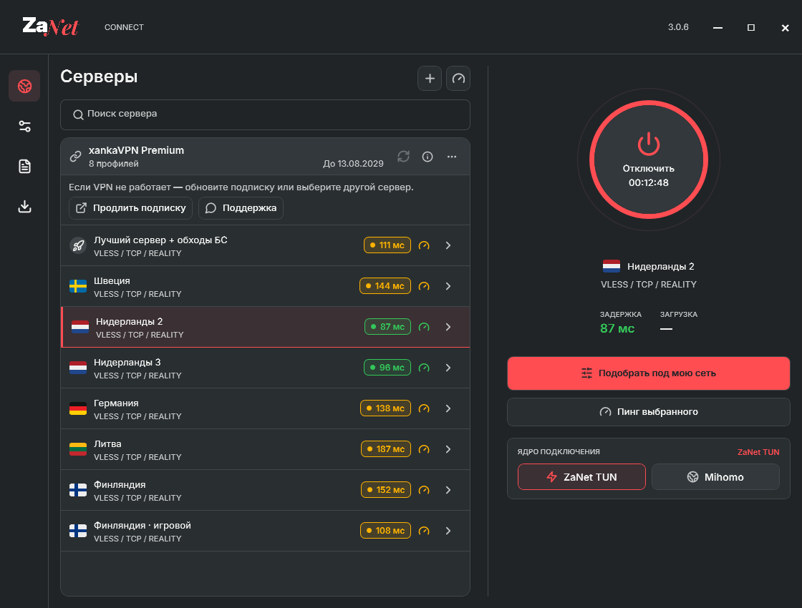
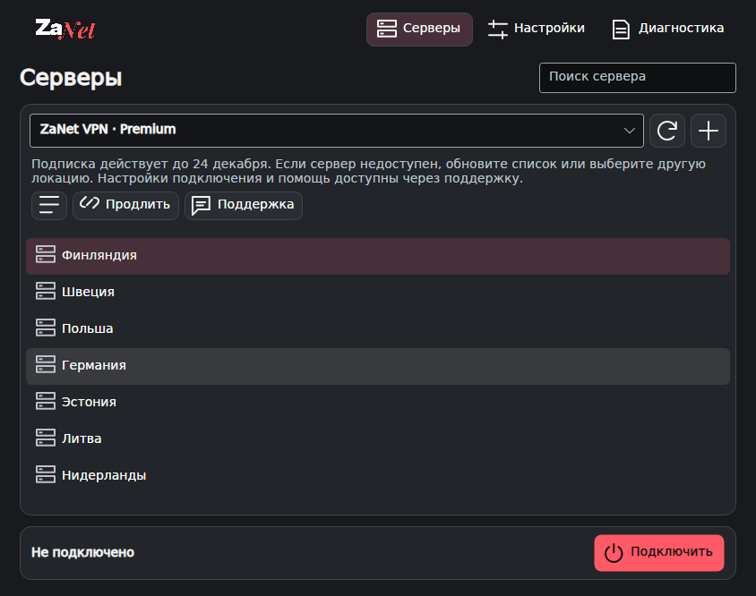

# ZaNet Connect

VPN-клиент для Windows, Android и Linux. Подключайтесь по подписке или отдельному ключу, управляйте маршрутизацией и проверяйте соединение прямо в приложении.

[**Последний релиз**](https://github.com/sacoq/ZaNet.Connect/releases/latest) · [Все релизы](https://github.com/sacoq/ZaNet.Connect/releases)

## Скачать

| Платформа | Сборка | Требования |
| :--- | :--- | :--- |
|  Windows | [Офлайн-установщик](https://github.com/sacoq/ZaNet.Connect/releases/latest/download/ZaNet-Connect-Windows-Offline.exe) · [Сетевой установщик](https://github.com/sacoq/ZaNet.Connect/releases/latest/download/ZaNet-Connect-Setup-Windows-x64.exe) | Windows 7 SP1, 8, 8.1 и Windows 10 до 1809 — x86/x64, .NET Framework 4.6.1 или новее. Windows 10 1809 и новее — x86/x64, .NET Framework 4.8. Windows 11 ARM64 — .NET Framework 4.8.1. |
|  Android | [Универсальный APK](https://github.com/sacoq/ZaNet.Connect/releases/latest/download/ZaNet-Connect-Android-Universal.apk) | Android 7.0 (API 24) или новее. ARMv7, ARM64 и x86‑64. |
|  Linux | [x64](https://github.com/sacoq/ZaNet.Connect/releases/latest/download/ZaNet-Connect-Linux-x64.tar.gz) · [ARM64](https://github.com/sacoq/ZaNet.Connect/releases/latest/download/ZaNet-Connect-Linux-arm64.tar.gz) | Дистрибутив на glibc с X11 или XWayland, библиотеками X11, ICE, SM и Fontconfig. .NET и Xray входят в архив. |

Офлайн EXE включает приложение, ядра и геобазы для всех трёх архитектур. Для установки нужна подходящая версия .NET Framework в Windows. Сетевой EXE загружает тот же офлайн-пакет с проверкой SHA‑256 и при необходимости предлагает скачать .NET с сайта Microsoft.

Сборка Windows 3.0.7 r4 устанавливается поверх 3.0.6 или 3.0.7 с сохранением подписок и настроек. Запустите свежий установщик вручную. Если сетевой EXE был скачан до r4, скачайте его ещё раз.

## Что изменилось в 3.0.7 r4

- Windows. Установщик выбирает ядра Xray 26.11.9, Mihomo и sing-box по версии Windows и архитектуре. Исправлен запуск ядер в 32-разрядном клиенте.
- Автоподбор проверяет до семи серверов одновременно через HTTP GET и сохраняет выбор после повторной успешной проверки. Сетевые параметры Windows и подписки сохраняются.

Матрица совместимости, установка поверх 3.0.7 и работа ядер x86/x64 проверены на Windows 11. Проверка установки и Wintun на самих Windows 7, 8 и 8.1 ещё не выполнена. Для старых Windows нужны [системные обновления](https://github.com/XTLS/go-win7#compatibility).

## Что изменилось в 3.0.6

Импорт из файла или текста поддерживает полный Xray JSON, Clash YAML через Mihomo и sing-box JSON. В «Настройки → Режим и ядро → Версии Xray» можно загрузить список официальных выпусков, увидеть размер и выбрать одну из установленных версий. Выбор применяется при следующем подключении.

Нативные профили Windows используют входы, DNS и маршрутизацию из самого файла. Подписки Clash и sing-box по URL, а также нативные профили этих форматов на Android и Linux в этой сборке недоступны.

- **Ядро Xray 26.11.9** на всех трёх платформах. В Windows также доступны ZaNet Mihomo 3.0.0 на базе Mihomo 1.19.30 и sing-box 1.14.0 для системного туннеля.
- **Экран подключения и список серверов обновлены.** В компактном окне Windows остаются видны список и кнопка подключения. В карточке подписки доступны описание, обновление и кнопки продления и поддержки, если они переданы провайдером. Разделы настроек представлены карточками с иконками.
- **Обновление подписки во время подключения на Windows и Linux.** В ходе проверки список менялся, а текущая конфигурация и процесс Xray продолжали работать. При временной ошибке сервера сохраняется последний полученный список.
- **Пинг подписки в Windows.** Кнопка в шапке проверяет до семи серверов одновременно. Текущий VPN-сеанс сохраняется.
- **Конструктор маршрутизации в Windows.** Задайте действие для домена, IP или подсети, проверьте список правил и сохраните профиль или скопируйте ссылку. Свою геобазу можно указать отдельной HTTPS-ссылкой для GeoIP и GeoSite.
- **Диагностика подключения.** Видны активное ядро и результаты проверок. На Windows для совместимых профилей отображается выход последней проверки через балансер. Запись адресов назначений включается по желанию. При экспорте исключаются ключи, ссылки подписок и сырые конфиги.
- **Импорт исходного JSON Xray.** В отдельном режиме ядро получает JSON или JSONC с заданными в нём маршрутизацией, DNS и входящими портами. Android использует этот режим в приложении на переднем плане. Системный VPN на Android работает с управляемыми профилями.

## Скриншоты

### Windows

### Android

  
  

### Linux

## Подключение

Подготовьте действующую подписку или совместимый профиль. Приложение поддерживает подписки по HTTPS, отдельные ключи `vless`, `trojan`, `hysteria2` и JSON. Локальные профили хранятся на устройстве. Ручной подбор сети и проверка задержки доступны в интерфейсе Windows и Android. На Windows можно выбирать GET, HEAD, TCP и ICMP, если метод доступен для профиля.

1. Импортируйте подписку или профиль.
2. Выберите сервер и нажмите кнопку подключения.
3. Если соединение нестабильно, проверьте сервер или запустите **«Подобрать под мою сеть»**. На Android результат подбора подтверждается проверкой трафика через туннель.

### Windows

Оба установщика определяют версию Windows и архитектуру. Сетевой установщик при необходимости скачивает .NET Framework с сайта Microsoft. Для офлайн-установки .NET Framework должен быть уже установлен.

В обоих Windows-установщиках можно выбрать папку и следить за ходом установки. В конце доступны ярлыки в «Пуск» и на рабочем столе, а также запуск приложения. Клиент по умолчанию запрашивает права администратора при новом запуске. Ссылки `zanet://` добавляют подписку в уже открытый клиент.

Установщики используют внутреннюю проверку SHA‑256 и целостности файлов. Windows может показать предупреждение о неизвестном издателе, поскольку у EXE нет подписи Authenticode.

### Android

Скачайте APK со страницы релиза. Если Android попросит разрешение на установку из выбранного браузера или файлового менеджера, подтвердите его для этой установки. Для первого VPN-подключения подтвердите запрос Android на создание VPN.

### Linux

Распакуйте архив и запустите `./zanet-connect`. Для ярлыка в меню приложений выполните `./install-user.sh`. В этой сборке подключения управляемых профилей работают через локальный HTTP `127.0.0.1:17892` или SOCKS5 `127.0.0.1:17890`. Укажите нужный адрес в приложении, которое должно использовать VPN. Быстрая проверка комплекта доступна командой `./zanet-connect --self-test`.

## Обновления и проверка файлов

При переходе с 3.0.5 на 3.0.6 скачайте установщик со страницы релиза и импортируйте подписку в новое приложение. Android-сборка 3.0.6 подписана новым ключом и имеет отдельное имя пакета.

В релизе есть файл SHA-256 и его подпись. GitHub также показывает SHA‑256 рядом с каждым файлом. В Windows контрольную сумму можно вывести командой `Get-FileHash <файл> -Algorithm SHA256`, в Linux — `sha256sum <файл>`.

## Поддержка

[Сообщить об ошибке](https://github.com/sacoq/ZaNet.Connect/issues) · [История версий](https://github.com/sacoq/ZaNet.Connect/releases)

Укажите версию клиента, платформу, шаги, при которых возникает ошибка, и её текст. Перед публикацией отчёта проверьте, что в нём нет личных данных, адресов назначений, которые вы не хотите раскрывать, и реквизитов подписки.

Лицензии сторонних компонентов сохраняют действие. Windows-дистрибутив содержит уведомления о лицензиях и соответствующие исходники модифицированного ядра Mihomo.

Этот репозиторий содержит готовые сборки и документацию ZaNet Connect.
