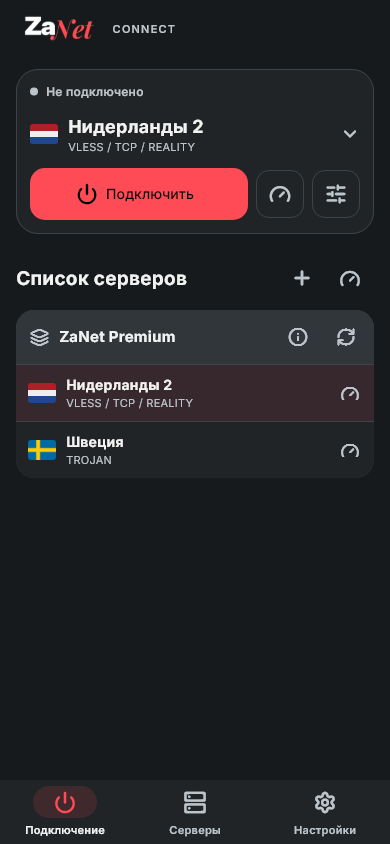
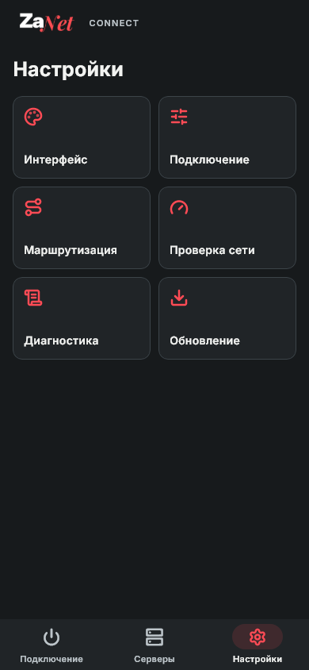

# ZaNet Connect

VPN-клиент для Windows, Android и Linux. Подключайтесь по подписке или отдельному ключу, управляйте маршрутизацией и проверяйте соединение прямо в приложении.

[**3.0.6**](https://github.com/sacoq/ZaNet.Connect/releases/tag/v3.0.6-release) · [**Версия 3.0.5**](https://github.com/sacoq/ZaNet.Connect/releases/tag/v3.0.5) · [Все релизы](https://github.com/sacoq/ZaNet.Connect/releases)

## Скачать 3.0.6

| Платформа | Сборка | VirusTotal | Требования |
| :--- | :--- | :--- | :--- |
|  Windows | [Универсальный установщик EXE](https://github.com/sacoq/ZaNet.Connect/releases/download/v3.0.6-release/ZaNet-Connect-3.0.6-Windows-Universal-Setup-r14.exe) | [EXE](https://www.virustotal.com/gui/file/5a5fe968156cafd400f539b432c61b0d7d4494d7911769adb003faa9d34033e4/detection) | Windows 10 1809 или новее и .NET Framework 4.8 для x64/x86. Windows 11 и .NET Framework 4.8.1 для ARM64. |
|  Android | [Универсальный APK](https://github.com/sacoq/ZaNet.Connect/releases/download/v3.0.6-release/ZaNet-Connect-Android-Universal.apk) | [APK](https://www.virustotal.com/gui/file/b2a44f49101d295d94d03bad39fbb57edd8cd07114046357e45708d2a4cf9481/detection) | Android 7.0 (API 24) или новее. ARMv7, ARM64 и x86‑64. |
|  Linux | [x64](https://github.com/sacoq/ZaNet.Connect/releases/download/v3.0.6-release/ZaNet-Connect-3.0.6-linux-x64-r4.tar.gz) · [ARM64](https://github.com/sacoq/ZaNet.Connect/releases/download/v3.0.6-release/ZaNet-Connect-3.0.6-linux-arm64-r4.tar.gz) | [x64](https://www.virustotal.com/gui/file/266df6185d9dc2051c335ae88c325362de114d94a80548c4a467fbd85eb65ce3/detection) · [ARM64](https://www.virustotal.com/gui/file/253adcf3fc03c0cca4c2c3733962bf59c6a8dfd1649ca667ddb71cf06e455f32/detection) | Дистрибутив на glibc с X11 или XWayland, библиотеками X11, ICE, SM и Fontconfig. .NET и Xray входят в архив. |

Ссылки VirusTotal ведут на страницы файлов по SHA‑256.

Установите 3.0.6 вручную. На Windows и Android её можно установить рядом с 3.0.5. У 3.0.6 своё хранилище профилей. При первом запуске импортируйте исходную ссылку подписки.

## Что изменилось в 3.0.6

- **Ядро Xray 26.11.9** на всех трёх платформах. В Windows также доступны ZaNet Mihomo 3.0.0 на базе Mihomo 1.19.30 и sing-box 1.14.0 для системного туннеля.
- **Экран подключения и список серверов обновлены.** В компактном окне Windows остаются видны список и кнопка подключения. В карточке подписки доступны описание, обновление и кнопки продления и поддержки, если они переданы провайдером. Разделы настроек представлены карточками с иконками.
- **Обновление подписки во время подключения на Windows и Linux.** В ходе проверки список менялся, а текущая конфигурация и процесс Xray продолжали работать. При временной ошибке сервера сохраняется последний полученный список.
- **Проверки серверов в Windows выполняются параллельно.** Отдельный пинг больше не задерживает выбор другого сервера. Быстрый подбор проверяет короткий список вариантов, а полный режим запускается отдельно. При смене параметров Xray сохраняются настройки Mihomo.
- **Диагностика подключения.** Видны активное ядро и результаты проверок. На Windows для совместимых профилей отображается выход последней проверки через балансер. Запись адресов назначений включается по желанию. При экспорте исключаются ключи, ссылки подписок и сырые конфиги.
- **Импорт исходного JSON Xray.** В отдельном режиме ядро получает JSON или JSONC с заданными в нём маршрутизацией, DNS и входящими портами. Android использует этот режим в приложении на переднем плане. Системный VPN на Android работает с управляемыми профилями.

## Скриншоты

### Windows

### Android

  
  

### Linux

## Подключение

Подготовьте действующую подписку или совместимый профиль. Приложение поддерживает подписки по HTTPS, отдельные ключи `vless`, `trojan`, `hysteria2` и JSON. Локальные профили хранятся на устройстве. Ручной подбор сети и проверка задержки доступны в интерфейсе Windows и Android. На Windows можно выбирать GET, HEAD, TCP и ICMP, если метод доступен для профиля.

1. Импортируйте подписку или профиль.
2. Выберите сервер и нажмите кнопку подключения.
3. Если соединение нестабильно, проверьте сервер или запустите **«Подобрать под мою сеть»**. На Android результат подбора подтверждается проверкой трафика через туннель.

### Windows

Универсальный установщик определяет архитектуру, выбирает подходящее ядро и при необходимости предлагает установить .NET Framework. Полный системный туннель может потребовать разрешения администратора. У установщика 3.0.6 нет подписи Authenticode, поэтому Windows может показать предупреждение о неизвестном издателе. Запуск приложения, импорт и локальный прокси доступны от обычного пользователя.

### Android

Скачайте APK со страницы релиза. Если Android попросит разрешение на установку из выбранного браузера или файлового менеджера, подтвердите его для этой установки. Для первого VPN-подключения подтвердите запрос Android на создание VPN. Для старой версии отдельно по-прежнему доступен [APK 3.0.5](https://github.com/sacoq/ZaNet.Connect/releases/download/v3.0.5/ZaNet-Connect-Android-arm64.apk).

### Linux

Распакуйте архив и запустите `./zanet-connect`. Для ярлыка в меню приложений выполните `./install-user.sh`. В этой сборке подключения управляемых профилей работают через локальный HTTP `127.0.0.1:17892` или SOCKS5 `127.0.0.1:17890`. Укажите нужный адрес в приложении, которое должно использовать VPN. Быстрая проверка комплекта доступна командой `./zanet-connect --self-test`.

## Обновления и проверка файлов

Для Windows 3.0.5 доступны [EXE](https://github.com/sacoq/ZaNet.Connect/releases/download/v3.0.5/ZaNet-Connect-Setup-Windows-x64.exe) и [MSI](https://github.com/sacoq/ZaNet.Connect/releases/download/v3.0.5/ZaNet-Connect-Windows-x64.msi). При переходе с 3.0.5 на 3.0.6 скачайте установщик со страницы релиза и импортируйте подписку в новое приложение. Android-сборка 3.0.6 подписана новым ключом и имеет отдельное имя пакета.

Сверяйте SHA‑256 скачанного файла с `SHA256SUMS.txt` на странице соответствующего релиза. В Windows контрольную сумму можно вывести командой `Get-FileHash <файл> -Algorithm SHA256`, в Linux — `sha256sum <файл>`.

## Поддержка

[Сообщить об ошибке](https://github.com/sacoq/ZaNet.Connect/issues) · [История версий](https://github.com/sacoq/ZaNet.Connect/releases)

Укажите версию клиента, платформу, шаги, при которых возникает ошибка, и её текст. Перед публикацией отчёта проверьте, что в нём нет личных данных, адресов назначений, которые вы не хотите раскрывать, и реквизитов подписки.

Лицензии сторонних компонентов сохраняют действие. Windows-дистрибутив содержит уведомления о лицензиях и соответствующие исходники модифицированного ядра Mihomo.

Этот репозиторий содержит готовые сборки и документацию ZaNet Connect.
